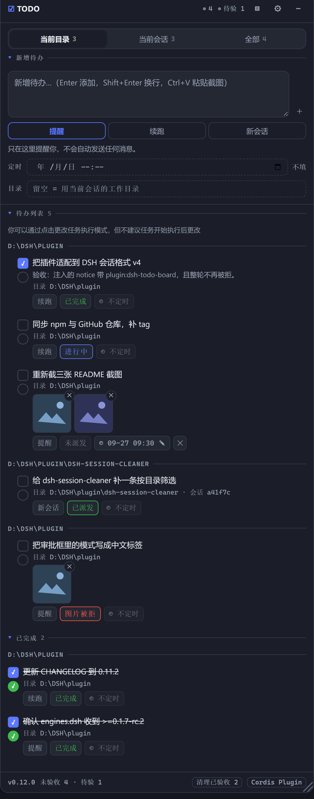
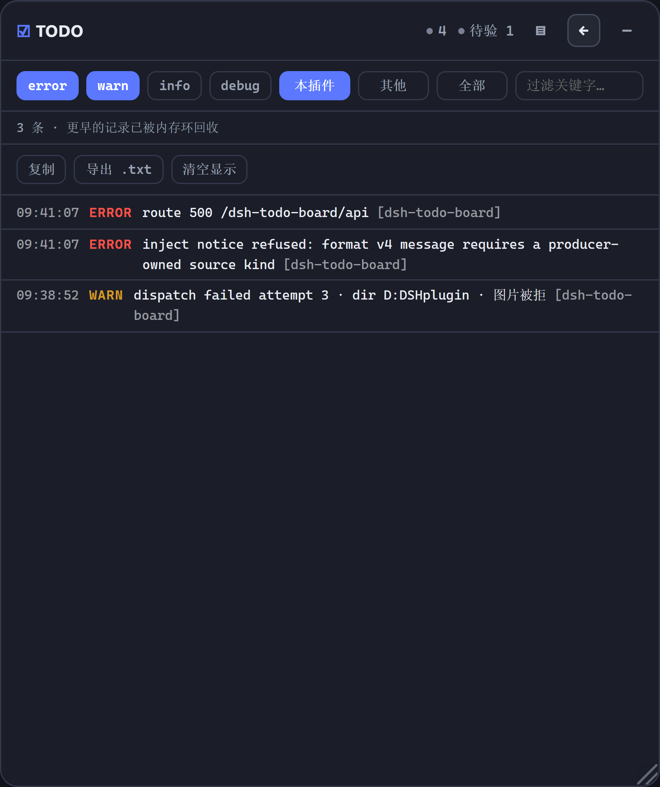
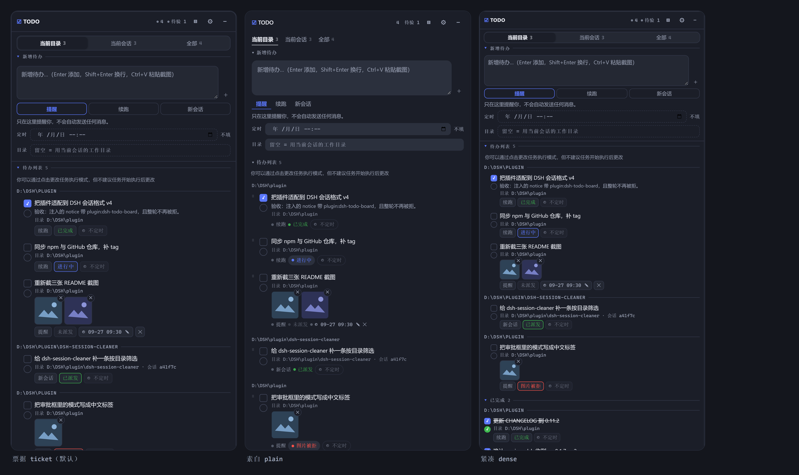

# dsh-todo-board

**给 DeepSeek Harness（DSH）agent 的一块跨会话 TODO 板：一次只派一件事，干完它自己去拿下一件。**

**A cross-session TODO board for DeepSeek Harness: hand the agent one task at a time, and it picks up the next one by itself.**

[](https://github.com/topics/dsh-plugin)
[](LICENSE)
[](package.json)
[](package.json)



---

## 它解决什么 / Why

让 AI 干完一件事之后，**自己**去待办板里找同一目录下还没做完的下一件继续干 —— 不用你盯着逐个验收，也不用一次把一堆任务塞给它、结果每件都做得半吊子。

待办按**工作目录**分组，列表顺序就是执行顺序；每条待办自己带一档执行模式（只提醒 / 自动续跑 / 自动新开会话）；AI 干完勾自己的左勾，你验收勾右勾，右勾才真正了结它。

- **面板**是一个浮窗（`shell.overlay`），拖动、缩放、折叠都在里面，位置和尺寸记在 `localStorage`。
- **板子是全局单文件**：`${DSH_HOME}/todo-board/board.json`，原子写入。面板内按目录分组显示。

Let the agent finish one thing, then look up the next unfinished task **in the same working directory** and keep going. Tasks are grouped by directory, list order *is* execution order, and only your own (round) tick closes one.

## 功能一览 / What you get

| 能力 | 一句话 |
| --- | --- |
| [跨会话自动接续](#三档执行模式--run-modes) | 回合结束时把同目录下一条未完成待办交给当前会话或新会话 |
| [三档执行模式](#三档执行模式--run-modes) | 提醒 / 自动续跑 / 自动新开会话，每条待办独立选 |
| [任务状态](#任务状态--task-states) | 每行都有且只有一个状态标签，从实时会话列表推导，永不落盘 |
| [卡住会自愈](#卡住的行不会静默卡死--a-stranded-row-recovers-itself) | 派发失败记 `lostAt` 并按退避重试，绝不静默退休 |
| [图片附件](#图片附件--attached-images) | `Ctrl+V` 粘贴截图，最多 4 张，派发时是**真正的图片** |
| [定时执行](#定时执行--scheduled-execution) | 本地时间到点才派发，列表里随时可改 |
| [双勾选](#双勾选--two-checkboxes) | 方形是 AI 自己勾的，圆形是你的验收；右勾才了结 |
| [界面风格](#界面风格--skins) | 蓝白 / 素白 / 紧凑 / 随主题四套，一键循环切换 |
| [开发者日志](#开发者日志--developer-log) | 面板内切页看日志，出错才亮小圆点，默认只记本插件 |
| [长任务先规划](#长任务先规划--plan-a-long-task-first) | 明显分多步时先问你要不要拆，`/todo` 一键注入模板 |
| [模型工具与审批门](#模型工具--the-todo_board-tool) | AI 改板子走 DSH 原生审批框，不问就执行不了（沙箱已放开完全访问时除外） |

## 安装 / Install

```sh
dsh plugin --profile web add dsh-todo-board          # 从 npm 安装 / from npm
dsh plugin --profile web add <git-url-or-path>       # 或从仓库/本地目录 / from a repo or local path
```

安装后**重启 Profile**（重新执行 `dsh web`）才会装载 —— 本插件是 host 组合里的一行，不是运行时热加载。

Restart the profile afterwards: the plugin is a row in the host composition, not a runtime hot-load.

卸载 / Uninstall：`dsh plugin --profile web remove dsh-todo-board`

### DSH 版本要求 / DSH version requirement

**本插件 0.11.2 起要求 DSH ≥ 0.1.7-rc.2，并已在 DSH 0.2.1-rc.2（桌面端）上验证。**

| 你的 DSH | 装哪个版本 |
| --- | --- |
| 0.1.7-rc.2 ~ 0.2.1-rc.2 | 当前版本（≥ `0.13.0`） |
| ≤ 0.1.6（含 `0.1.5-rc.3`） | `dsh-todo-board@0.6.1`（最后一版 v3 兼容版本） |

会话格式在这两端**都是 v4**，所以同一条适配覆盖两者。插件注入的每条消息都带一个**生产者自有的 source**（`{ kind: 'plugin:dsh-todo-board', form: 'notice' }`）：这是 v4 的硬性要求，旧 v3 的写法会被持久化层拒绝，而**拒绝会带走整个回合**——不只是那条提示。不带这个适配的发布版只有 **0.4.1 / 0.5.0 / 0.6.1**。

**0.2.1-rc.2 的实际核对结论**：会话格式仍是 v4（`SESSION_FORMAT_VERSION = 4`），插件依赖的 14 个 host 服务、4 个 host 事件、`shell.overlay` slot、以及 `useSessions` 的 store 形状**全部未变**。逐项证据见 [`docs/report-0.2.1-compat.md`](docs/report-0.2.1-compat.md)。

#### 版本门是 peer，不是 engines / The gate is a peer, not an engine

`engines.dsh` 是一扇**哑门**：npm 只校验它认识的引擎名（`node` / `npm`），自定义引擎名不参与检查 —— 装在 DSH 0.1.5 / 0.1.6 上**不会有** `EBADENGINE` 警告。它因此保留着（把范围也留给了 DSH 自己读），但它只是一个**声明**，从来不是门。

从 **`0.13.0`** 起，包里多了一条真正会拦的 peer 依赖：

```json
"peerDependencies": { "@deepseek-ai/dsh": ">=0.1.7-rc.2" }
```

peer 由 npm 的解析器执行（`includePrerelease: true`，所以 `0.2.0-rc.2` 这类预发布版本能被正确匹配），装错版本在**安装那一步**就被挡下：

| 已装的 DSH | 结果 |
| --- | --- |
| `0.2.1-rc.2`（当前桌面端） | ✅ compatible |
| `0.2.0-rc.2` | ✅ compatible |
| `0.1.7` / `0.1.7-rc.2` | ✅ compatible |
| `0.1.6` | ⛔ BLOCKED，并告知需要 `{"@deepseek-ai/dsh": ">=0.1.7-rc.2"}` |

> **为什么没有上界。** 这里刻意不写 `<0.3.0` 之类的上限。实测（`includePrerelease: true`，与 npm 解析 peer 时的选项一致）：`<0.3.0` 能挡住 `0.3.0`，却**挡不住 `0.3.0-rc.1`**；要真挡住预发布得写 `<0.3.0-0`，而这会把走 nightly 通道的人直接锁在门外。一个拦不住 next 的上界只是假安慰，代价却是实打实的误伤，所以范围只声明下界。

> **版本差别是行为差别。** `0.13.0` 以前装错版本一路畅通、无声无息，实际表现是**运行时报错**（原因写进插件日志）；`0.13.0` 起它会**当场**被拦下，而不是等运行时才炸。反过来说，如果你要留在 DSH `0.1.6` 或更早，就得显式装 `dsh-todo-board@0.12.0` 或更低 —— 那几版没有这道 peer 约束，但也同样没有这层保护。

## 快速上手 / Quick start

1. 右上角出现浮窗，输入一条待办，选执行模式，点「添加」。
2. 让 AI 去做这件事。它做完会调用 `todo_board action=done` 给自己打左勾，然后查同目录下一条。
3. 你验收后点右勾；底部「清理已验收」批量清掉。



## 三档执行模式 / Run modes

每条待办在新增时选一档（默认「提醒」）。

| 模式 | 行为 |
| --- | --- |
| 提醒 | 不自动做任何事，等你在浮窗里点 ▶ |
| 自动续跑 | 回合结束时，把下一条待办注入**当前会话**继续跑 |
| 自动新会话 | 回合结束时，新建一个同目录会话并执行该待办 |

「目录」一行决定这条待办**归属哪个目录**：分组标题、能否在「当前目录」里看到、回合结束后由哪个会话接续，都看它。**留空 = 跟随当前会话的工作目录**。

派发顺序 = 面板里**从上到下**的顺序，拖动行首 `⠿` 调整，持久化。选择是**按归属**而不是按目录：一条待办只被它所属的那个会话接走，同目录的另一个会话不会顺手拿走你的活。

「自动新会话」第一次派发时创建会话并**绑定**到这条待办，之后复用同一个会话，不会一次运行开一个。绑定会话不在了才会再开；点行上的 `会话 … ✕` 解绑可手动换一个。

## 任务状态 / Task states

状态由 host 从**实时会话列表**推导（不落盘，避免与实际不一致）。**每一行都带且只带一个状态标签**——需要靠推断才知道的状态等于看不见：

| 状态 | 含义 |
| --- | --- |
| `未派发` | 还没交给任何会话；▶ 可点 |
| `已派发` | 已交给会话，目标还活着 |
| `进行中` | 目标会话此刻正在跑 |
| `已完成` | AI 打了左勾，或你打了右勾 |
| `目标会话丢失` | 派发时找不到目标会话，悬住了 |

只有 `进行中` 和悬住的行显眼。`已完成` 的**划线**只跟验收走，所以 AI 勾完但你没验收的行会显示「已完成」而依然清晰可读。

「悬住」的原因不止一种，面板按实际原因显示：`目标会话丢失`、`图片被拒`（会话是好的，别冤枉它）、`建会话失败`、`预设解析失败`、`服务不可用`；tooltip 写清原因和出路。

**▶ 只能在「未派发」时点击。** 重复派发只会产生重复工作。

**派发失败不会盖上「已派发」的戳。** 那个戳的含义是"已经发出去了"，而调度器和钩子都会按它跳过——盖上就等于把这条待办永久退休。取而代之的是记录 `lostAt` 并按退避重试（首次 1 分钟后翻倍，最多半小时一次）。改模式、换目录、解绑会话都会立刻清掉标记让它重新排队；卡住的待办也不会挡住后面的条目。

## 图片附件 / Attached images

待办可以带图片（最多 4 张，PNG / JPG / WebP / GIF）。图片存进 DSH 的**附件库**，派发时作为**真正的图片**和提示词一起发给模型——不是把文件名写进文字里。

- **在新增框里直接 `Ctrl+V` 粘贴截图**即可附图，粘完显示缩略图，点缩略图移除。原来的「📎 图片」选文件按钮已删除。行上的缩略图点击可放大，✕ 移除单张。
- **输入框空着时没有任何常驻提示**：能力由 placeholder 里的 `Ctrl+V 粘贴截图` 说明，附图区只在真的附了图之后才出现。
- **纯文本粘贴不受影响**：只有剪贴板里真的带图片时才会拦截粘贴。
- 一次粘太多会**粘满为止并告知**（「只粘贴了前 N 张」），而不是静默丢掉。
- 剪贴板图片有时**不带 MIME 类型**；这种会按文件名的扩展名补上类型再交给 host（host 对媒体类型是严格校验的）。
- 图片字节由本插件自己的 `GET /dsh-todo-board/image?id=…` 提供：harness 自带的图片读取是**会话作用域**的，而待办的附件存在板上，所以板自己当权威——没被任何待办引用的 id 一律 404。
- **目标模型必须支持图片**：派发前会查模型是否声明了 `image`，文本模型会得到明确提示而不是适配器抛错。

## 定时执行 / Scheduled execution

每条待办都可以带一个**本地时间**（`YYYY-MM-DDTHH:mm`，分钟精度）。到点之前不会被派发；到点之后 DSH 按它自己的模式执行它——就像你此刻按了 ▶。

- 新增框里的「定时」一行用浏览器的时间选择器挑时间；留空 = 立即可执行。
- **列表里的待办也能改定时**：没定时的行显示 `🕓 不定时`，点一下就地展开选择器；已定时的行点标签打开同一个选择器（带着当前时间），`Enter`/`✓` 保存、`Esc` 取消，标签旁的 `✕` 单独取消定时。
- 行上的定时标签显示时间，**已到点**会变黄。
- `提醒` 模式到点只弹一条桌面通知（需要浏览器通知权限）；`自动续跑` / `自动新会话` 到点才真正派发。
- 定时只判一次；错过的时间（DSH 当时没运行）会在下次启动后立刻补上。时间用**主机本地时区**解释。

## 双勾选 / Two checkboxes

| 勾 | 谁勾 | 含义 |
| --- | --- | --- |
| 左（方框） | 模型自己调 `todo_board action=done`，也可手点 | AI 已完成，等你验收 |
| 右（圆框） | 只有用户 | 已验收，真正了结 |

只有**右勾**才把待办从未完成列表里移除，系统提示段落明确禁止模型代勾右勾。

勾上右勾时这一行**从「待办列表」移走、进入「已完成」区块**——不是变灰留在原地，是真的换了一个列表。新区块在待办列表和面板之间，**最近验收的排在最上面**，按目录分组，同样可折叠。再点一次那个圆勾就撤销验收，行会回到待办列表。已完成的行不参与执行顺序：没有拖柄、也不能被拖成落点（`▶` 与 ✕ 仍然可用）。

## 界面风格 / Skins

四套界面，标题栏的 `◻` 循环切换。默认是**蓝白极简**：白卡片、蓝色强调、状态是一块淡色而不是一圈边框。



| 界面 | 它改什么 |
| --- | --- |
| 蓝白 `ticket` | 默认：白卡片 + 蓝色强调，状态是淡色标签，细线分隔 |
| 素白 `plain` | 去掉卡片边框与分隔线，留白更多；状态标签收成一个色点 |
| 紧凑 `dense` | 结构同默认，字号行距各降一档，图片缩略图变小 |
| 随主题 `theme` | 跟 DSH 界面走：深色界面下这块板也是深色的 |

**四套界面里，控件一个不多一个不少，意思也不变。** 方形是「AI 已完成」、圆形是「已验收」——那是含义，不是装饰。切换只动外观，不碰任何数据，也不影响 DSH 其他界面（每条皮肤规则都限定在本面板根节点之下）。

皮肤是**只加不改**的样式表：基础表描述默认那套，另三套只声明自己不同的地方，所以写错时退回的是「原来那套界面」而不是「没有样式」。颜色全部先落到一组 `--tb-*` 变量上，于是「随主题」只是把那组变量重新绑到 DSH 的主题令牌——同一份排版，只换颜色。

## 面板操作 / Panel

- **折叠为一行**：标题栏 `–` 把整板收成一行（`TODO · 未完成数 · 下一条待办 · 待验 N`），点这一行任意位置展开。**折起后仍可拖动**，位置与展开态共用同一份存储；位移小于 3px 仍算点击。
- **拖动 / 缩放**：拖标题栏移动，右下角 `◢` 缩放；双击标题栏或拖柄还原。**窗口变窄时自动收回视野内**，拉宽时回到你放它的地方。位置与尺寸存在**主机端的 `board.json`**，换端口、换浏览器、重启都保持。
- **区块折叠**：面板内部三个区块（新增待办 / 待办列表 / 已完成）各自可折叠，状态记 `localStorage`，刷新后保持。
- **底部状态线（不可折叠）**：左下方常显**版本号**与**未验收数量**——不是可折叠区块，所以不会被折起来后"看不见就当没有"。右侧是 `清理已验收 N` 与 `Cordis Plugin` 两条功能入口。
- **筛选**：当前会话 / 当前目录 / 全部，每段带未完成计数。
- **行内编辑**：双击标题改名；点模式标签在 提醒 → 续跑 → 新会话 之间循环；点定时标签改时间。
- **备注（note）**：有备注的行在标题下方显示正文（最多 2 行，紧凑界面 1 行，悬停看全文）。行尾「＋ 备注 / ✎ 备注」是它**自己的**控件：多行框，`Enter` 保存、`Shift+Enter` 换行、`Esc` 取消。**不裁剪、不设上限**——它是派发时一起发给模型的上下文。
- **多行输入**：新增框自动增高（3 行起，最高 180px），`Enter` 添加、`Shift+Enter` 换行、`Ctrl+V` 粘贴截图。
- **Cordis 入口**：侧边栏底部的 `Cordis Plugin` 按钮折起，入口移到本面板底部；点它打开原面板，出现在**本面板正下方**。找不到入口时按钮变灰并提示。

## 开发者日志 / Developer log

标题栏 `⚙` 把面板**在同一个浮窗内**切到日志页（不是新窗口、不进 DSH 设置页）。**平时不出现在你的工作流里**：出问题时按钮亮小圆点，点开看完即清。

- **过滤**：级别（error / warn / info / debug，至少保留一个）、来源（本插件 / 其他插件 / 全部）、关键字。**最新在最上面**——打开它的理由通常就是刚坏掉的那件事。
- **复制 / 导出 .txt / 清空显示**。清空**只清面板，不动主机记录**。
- **默认只记本插件**（自己的 debug 也记，别的插件只收 error）。
- **日志正文只在日志页打开时才传给浏览器**。关着时轮询负载与没有这个功能时**逐字节相同**，只多带一个数字（圆点就是这么来的）。
- 位置：`${DSH_HOME}/todo-board/log.ndjson`，一行一条，上限 256 KiB（超了保留最新一半），权限 `0o600`。写不进去只是不再落盘，内存日志照常。

失败路径都会留痕：派发失败（含**第几次**、目标会话、目录、原因）、读写板失败、建会话 / preset 失败、图片入库失败、路由 500，以及被信任校验拒绝的请求（**同一来源只记第一条**）。

> **脱敏是承重结构，不是加固。** 密钥从来不是被某处不小心的 `logger.warn(secret)` 记下的，而是夹在**别人构造好的消息**里——通常是配置校验失败时的 `Error.message`。所以**每一行落盘前都过脱敏**，导出时**再过一遍**。已知未覆盖：JSON dump 里、键名不像密钥、值也没有可识别前缀的密钥。

## 长任务先规划 / Plan a long task first

给模型一个多阶段任务时，它**应该先问一句**要不要用 TODO 板拆成步骤、按顺序做。这个能力由三部分组成：

| 谁 | 用什么 | 做什么 |
| --- | --- | --- |
| **模型** | 系统提示段落里的一条规则 | 明显分多步、且**当前目录下还没有待办**时，先问一句「要不要拆」；已经拆过就不再问 |
| **你** | `/todo <目标>` 命令 | 一句话把模板注入当前会话，模型随即给计划 |
| **你/模型** | Skill `todo-board-planning` | 拆分手册（粒度、note 写什么、模式怎么选），模型按需加载 |

### 确定性提醒与它的两个阈值 / The deterministic nudge

上面那条是**提示词里的软规则**，模型可以不理。所以还有一层**硬规则**，跑在主机端：当你的消息同时满足三个条件时，插件会在这一轮里追加一句「这条请求看起来不止一步，要不要拆」。

```
字数 ≥ 200  且  条目数 ≥ 2  且  当前目录下没有未完成待办
```

两个阈值：**字数**（默认 200，这条消息至少多长）与**条目数**（默认 2，至少出现几次「阶段标记」——编号 `1.`/`2)`、列表 `-`/`*`、顺序词「第一步/其次/最后」、名词「阶段/步骤/流程/里程碑」）。**两项都要满足**：只看长度，贴一段报错就会触发；只看标记，「1. 改个错别字」也会触发。

#### 怎么调 / Adjusting it

面板标题栏的 **⚒**（设置）按钮里有四项：

| 项 | 范围 | 说明 |
| --- | --- | --- |
| 长任务主动提醒 | 开关 | 关掉就**完全不提醒**，也不消耗「每会话一次」的额度 |
| 字数 ≥ | 10–10000 | 太短的就不算计划 |
| 条目数 ≥ | 1–100 | 阶段标记至少出现几次 |
| 单次回合最多新开会话 | 1–50（默认 10） | 一次回合结束最多开几个新会话 |

超出范围主机端会拒绝保存并在面板上说明原因。设置存在 `board.json` 的 `settings` 字段里，跟着板子一起原子写入，跨浏览器一致。

> **为什么「单次回合最多新开会话」值得调**：一个回合结束时，队列里 `newSession` 模式的待办会各开一个新会话，这个数就是「一次最多开几个」。计划最多能有 **20 步**，而默认只派 10 条——超过的**留到下一次回合结束**，不会丢，但如果你不再触发回合，它们就不动。计划长就调大。

### 复制这段给模型

```
用 TODO 板把这件事拆成可执行的步骤，然后按顺序做。

【目标】<一句话说清最终要什么>
【边界】<不要做什么、必须遵守什么>
【完成标准】<怎么算做完；能跑命令/看结果最好>

拆分要求：
1. 每条一句话、彼此有顺序、能独立验收；一条只交付一件事，别把两件事塞一条；
2. 先给我看拆分结果，我确认后再写进板子；我说改就改；
3. 每条待办的备注（note）里写清：验收标准 + 已知的坑/前置条件；
4. 定好顺序后，用一次 action="add" 的 items 把整份计划写进去（一次审批），不要一条一条建。

执行要求：
5. 开始后每做完一条，立刻 action="done" 勾成「AI 已完成」，再取同目录下一条继续，不要停下来问我；
6. 中途要加步骤就告诉我，别自己闷着改范围。

（我没特别说的话：默认拆 3–8 步；建好后用 ask_user_question 问我「就按这个做（立刻开始）／只建清单不开始／我再改改」。）
```

> 这段模板在代码里只有**一处**定义（`PLAN_TEMPLATE`），`/todo` 命令、Skill 正文与本 README 共用它；`tools/check-template-parity.mjs` 会逐字比对上面这个代码块，防止"文档里那份悄悄过期"。

**一次写入整份计划**：`add` 传 `items` 数组即可。一次调用 = 一次审批框（框里逐条列出每一步的标题），数组顺序即执行顺序，上限 20 条；**任意一条不合法 → 整批一条都不写**。每步可以有自己的 `mode` / `note` / `schedule` / `images`。

**执行模式怎么选**：`resume`（推荐，同一会话连跑）、`newSession`（每步开新会话，适合步骤互相独立）、`remind`（只建清单，你自己点 ▶）。模型建完后应当用 `ask_user_question` 问你，「就按这个做」就等于**你授权了第一步**。

**确定性提醒**：提示词里的规则是"软"的，所以插件还在 `agent/pre-step` 上加了一道保守判断——当这一步进来的用户消息同时满足「长度 ≥ 200 字」「出现 ≥ 2 处阶段标记」「当前目录下没有未完成待办」「这个会话还没被提醒过」，才追加一句"这看起来不止一步"。两个阈值都在 `lib/index.js`（`PLAN_NUDGE_MIN_CHARS` / `PLAN_NUDGE_MIN_MARKERS`），误报的代价只是多问一句。

## 模型工具 / The `todo_board` tool

| action | 作用 |
| --- | --- |
| `list` | 列出当前工作目录下未验收的待办（`all: true` 列全部目录），带 id、执行顺序与定时时间 |
| `add` | 新增一条（追加到底部），可带 `schedule` 与 `images`；**给 `items` 就能一次写入整份计划** |
| `done` | 打左勾「AI 已完成」 |
| `reopen` | 撤销左勾 |
| `note` | 追加备注 |
| `schedule` | 设置或取消定时时间（传空字符串即取消） |
| `update` | 改标题 / 模式 / 目录 / 备注；**先整体校验再落笔**，一个字段不合法就整条拒绝 |
| `reorder` | 传 `ids` 指定新的从上到下顺序。**只接受同一个目录内的待办**；未列出的保持原有相对顺序 |
| `dispatch` | 立即派发一条待办（等于面板的 ▶）。**只有「未派发」的能派发** |

工具输出 schema 是 `additionalProperties: false` 的严格 JSON Schema，返回值只含声明过的字段。

### AI 改板子要你批准 / Approval for board writes

**模型写板子走 DSH 的原生审批框**（`tools/pre-execute` → `ask` → `dsh-user-approval`），所以这不是提示词里的约定：不问就执行不了，而且被拒绝时模型收到的是一个**真正的失败结果**。门装在**工具注册表这一层**，在任何工具体执行之前——所以在门还有意义的档位下，模型没有绕过的路径（唯一例外见下面的「`never` 与完全访问」）。

| action | 要审批吗 | 为什么 |
| --- | --- | --- |
| `list` | 不用 | 只是读 |
| `done` / `reopen` | 不用 | 这是模型自己的左勾。「做完一条就勾掉、再取下一条」就是你要的自动接续；在 `danger-full-access`（审批档 `never`）下每次都会变成拒绝，那条链子会当场断掉。**用哪个预设见下一节。** |
| `note` | 不用 | **0.13.4 起**：备注只是写在某一行上的文字，不删除、不改标题/模式/目录、不新建会话、不派发任何任务。在 `never` 下要求审批等于让它永远失败，而这恰好是「干完一步顺手记下下一步要什么」这个循环的一部分 |
| `add` / `schedule` / `update` / `reorder` / `dispatch` | **要** | 都在改板子（`dispatch` 也是：它替用户启动了队列；`schedule` 也是：它让这行到点自己跑） |
| 将来新增的写动作 | **要**（默认就是"要"） | 白名单里没写的一律问——漏加一个动作必须失败关闭 |

**唯一的免问写操作**：当沙箱本身就是 `danger-full-access`、且审批档是 `never` 时（两个**旋钮**同时满足，与面板上显示的是哪个预设名无关），写操作**直接放行、不弹框**（**0.13.5 起**）。理由见下面「`never` 与完全访问」——那种组合下弹框必然被拒，而模型本来就能绕过这个工具直接改 `board.json`。

注意这条只说**本插件的门**不弹框。如果预设显示是 `auto`（自动审查），审查那一层仍然会先跑一遍 LLM 风险评估、并且**仍可能**拦下来——`never` 下它的结果是最终裁决，本插件的放行管不到它。想要「写板子完全不被打断」，用 `danger-full-access` 预设本身，别停在 `auto` 上。

**审批挡的是「改板子」，不是「跑队列」**：面板的 ▶、自动接续、定时到点派发都不需要审批——后两者根本不是工具调用，也在回合之外。「逐次确认」是默认，要少被打断就用 `/permission` 切档，不需要本插件实现"记住已授权"。

#### 该用哪个权限预设 / Which permission preset to use

**推荐 `workspace-write`。** 三个预设的差别只有两个旋钮：

```
预设 = (沙箱 sandbox, 审批 approval)
```

| 预设 | 沙箱 | 审批 | TODO 板能不能正常跑 |
| --- | --- | --- | --- |
| **`workspace-write`** | `workspace-write` | `ask` | ✅ **全都正常** |
| `danger-full-access` | `danger-full-access` | `never` | ✅ **0.13.5 起全都能用**（写操作不弹框，见下节） |
| `auto`（自动审查） | `danger-full-access` | `ask` | ⚠️ **自动接续可能静默中断** |

##### `never` 与完全访问：为什么现在放行（0.13.5）

`never` 的规则是「需要审批的动作 → 一律拒绝，连弹窗都没有」。所以在 0.13.4 及以前，这个预设下写板子会失败并报 `the user rejected tool "todo_board"`——这句话**不是说你拒绝了**，是「没地方问，只好当作拒绝」，很容易误导。

0.13.5 起分情况处理。**放行的条件不是「审批档是 `never`」**，而是两个旋钮**同时**满足：

| 条件 | 为什么 |
| --- | --- |
| 审批档 = `never` | 弹框注定被拒，问也白问 |
| 沙箱 = `danger-full-access` | 这堵墙本来就没在挡人（见下） |

这两个值分别来自**各自最权威的那一侧**，都不是拿预设的名字去猜：

- **审批档**直接问审批服务（`approval.effectivePolicy(session)`）——它才是「这个会话到底要不要弹框」的权威来源。
- **沙箱**从当前预设解析出的组合里读。DSH 的预设表（`permissionPresets` 的 `presets`）是**可配置**的，名字只是标签，谁都能把 `danger-full-access` 这个键指向别的组合。插件把 `current(session)` 返回的预设名解析回它的组合，再比对 **`沙箱` 字段的值**——换个表也照样对。

**为什么审批档不能也从预设里读**：`current()` 返回的是**预设的定义**，不是旋钮的实时值。举例：你先选了 `auto`，之后又把审批档改成 `never`——此时 `derive()` 仍然返回 `auto`（它是「还选着的 Auto」），而 `auto` 这个预设的定义永远写着 `approval: ask`。要是拿这个字段当审批档，一个**真的**「完全访问 + never」的会话会被一直拒掉。沙箱字段没有这个问题：`derive()` 的每个分支都保证它与真实沙箱一致。

**为什么必须看沙箱**：`sandbox` 和 `approval` 是两个**互相独立**的旋钮，`never` 完全可以配 `read-only` / `workspace-write`（这时预设显示为 `custom`）。而本插件写 `board.json` 用的是**宿主权限，不经过 shell 沙箱**——沙箱受限时，审批门是模型与这个文件之间**唯一**的东西。那种情况下让 `never` 变成通行证，等于凭空开出一条沙箱没批准的写通道。所以：**`never` + 受限沙箱 → 照样拒绝**，只是错误信息现在会点名真正的原因，不再冒充「用户拒绝了」。

**为什么完全访问下放行反而更安全**：沙箱已经是 `danger-full-access` 时，模型本来就能用文件工具直接改 `board.json`——预设自己的说明就是「完全文件访问，不弹审批框」。硬要它走审批，只会把它逼去手改 JSON，而那样会跳过参数校验、跳过 `seq` 计数、跳过原子替换。让它用正规工具是两害相权。

**读不到就照旧问**：审批档或预设读不出来时（服务缺失、投影未注册），一律当成「问不出结果」，继续弹框，绝不当成「可以放行」。反过来，沙箱是 `danger-full-access` 但审批档是 `ask` 时也照常弹框——放行必须两个条件同时成立。

这两条假设跟着一条常驻检查（`tools/check-permission-derive.mjs`）走：它加载**真实的** `dsh-permission-presets`，把 `derive()` 在「3 种沙箱 × 2 种审批档 × 5 种预设选择 × 3 张预设表」共 90 个状态上跑一遍，断言放行条件成立时真实沙箱**一定**是完全访问。所以哪天 DSH 改了 `derive()` 的行为，这里会先响。

大白话：**「完全权限」放开的是「能碰什么」；现在它也能让"不用问"生效，但只在沙箱确实没在挡的时候。**

##### 为什么 `auto`（自动审查）也会挡

自动审查挂在工具调用链的**最前面**，每次调用先做一次 LLM 风险评估；`done` 虽免本插件的审批，却**仍要过这道审查**。一旦被判成需要人确认，那条续跑链就在**不报错**的情况下停住。

**没有「既自动审查又完全放行」的档**：审查只在预设恰好是 `auto` 时生效，而 `auto` 固定带 `approval: ask`。想要审查就必然 `ask`，想要 `never` 就必然没有审查。**`workspace-write` 是唯一「审查不介入、写板子又能用」的档位**，代价是沙箱限制在工作目录内 + 每次写板子点一次确认。

> 完整机理与源码证据见 [`docs/report-auto-review-conflict.md`](docs/report-auto-review-conflict.md)。

## 数据 / Data

`${DSH_HOME}/todo-board/board.json`（默认 `~/.dsh/todo-board/board.json`），原子写入（临时文件 + rename）。文件缺失时自动创建；读坏或写失败会在浮窗底部红字提示。开发者日志在同目录的 `log.ndjson`。

同一个文件里还存着两类**偏好**，都跟着板子走：

| 字段 | 存什么 |
| --- | --- |
| `settings` | 规划提醒的开关与三个阈值（见「长任务先规划」） |
| `layout` | 浮窗最后停放的位置与尺寸 |

**为什么位置存在主机端而不是 localStorage**：storage 按 **origin** 隔离，`127.0.0.1:41012` 和 `127.0.0.1:25005` 在浏览器看来是两个网站——DSH 换个端口重启，面板就"忘了"自己停在哪。存进 `board.json` 之后换端口、换浏览器都还在。浏览器里仍留一份 localStorage 兜底，供路由不可达时使用。

**会话生命周期**：「自动新会话」创建的会话走 `ctx.root` + `agentPresets.mount()`，归属**应用根上下文**而不是本插件行，因此停用 / 更新 / 卸载本插件不会连带拆掉这些会话。

## 结构 / Layout

```
package.json          dsh.bundle.patch → cordis.patch.yml；dsh.client.platform = web
cordis.patch.yml      向 profile 树 insert 一行 todo-board
lib/index.js          Host：板文件、todo_board 工具、审批门、回合结束钩子、提示词段落、
                      日志 exporter、/dsh-todo-board/api 与 /dsh-todo-board/image
client/client.js      Browser：shell.overlay 浮窗；三套皮肤、粘贴附图、日志页都在此
tools/                smoke / client-smoke / check-http / check-live / check-browser /
                      check-fence-parity / check-session-format / check-template-parity /
                      check-*-guard（变异检查）/ capture-fixture（重生成截图）
```

Host 半刻意不 import 任何 `@deepseek-ai/*`：profile 安装的插件从自身目录解析模块，harness 包在那里不可达，一切通过 `ctx`。

## 开发 / Development

```sh
npm run check        # node --check 两个入口
npm test             # 8 个套件：两半 smoke、重试、真实 HTTP、真实 cordis、围栏对表、会话格式、模板对表
npm run guard        # 变异测试：把每个修过的行为改坏一次，要求测试必须抓到
npm run test:browser # 真实 Chrome 里验证皮肤、粘贴、折叠拖动（需 Chrome，可设 DSHTB_CHROME）
```

**改客户端只需刷新页面；改 Host 半要重启 Profile。** 桌面端同理由 `dsh-client-hmr` 自动发现客户端改动（500ms 轮询 + SSE），Host 半要重启应用。

`npm run guard` **会临时改写 `lib/index.js` / `client/client.js`，跑完逐字节还原**——别在同一时刻手动改这两个文件。它不是重复劳动：一条永远不会失败的断言和没有断言是一样的。

`check-live.mjs` 补的是 **stub 与真实运行时的语义差**（真实 cordis 要等服务被 provide 才唤醒）。可用 `DSHTB_CORDIS` / `DSHTB_TOOLS` / `DSHTB_SESSION` 指向任意 DSH 安装，**包括桌面端 `app.asar` 里那份**：

```bash
DSHTB_CORDIS="file:///<asar>/dsh/node_modules/@deepseek-ai/cordis/lib/index.js" \
DSHTB_TOOLS="file:///<asar>/dsh/node_modules/@deepseek-ai/dsh-tools/lib/index.js" \
ELECTRON_RUN_AS_NODE=1 "<DSH 安装目录>/DeepSeek Harness.exe" tools/check-live.mjs
```

其余细节见 `docs/`（0.2.1 适配报告、自动审查冲突分析）与代码注释。**Host 半刻意不 import 任何 `@deepseek-ai/*`**：profile 安装的插件从自身目录解析模块，harness 包在那里不可达，一切通过 `ctx`。

### 截图 / Screenshots

```sh
node tools/capture-fixture.mjs     # 重生成 assets/screenshot-*.png（推荐：无需登录、可重复）
node tools/capture-screenshots.mjs # 从运行中的 GUI 抓图（需要那个 profile 的浏览器凭据）
```

`capture-fixture.mjs` 加载**真的** `client/client.js`，用**它自己安装的**样式表，再按组件真实渲染结构搭出固定件。**开图之前**它会断言固定件用到的每个类名都在插件样式表里声明过：类名被重命名时，固定件仍然会"渲染成功"，但它渲染的是**没有样式**的面板——而一张不存在的面板截图比没有截图更糟。

## 已知限制 / Limitations

- 浮窗**在页面可见时**每 2.5s 轮询一次 `/dsh-todo-board/api`，不是推送（日志页复用同一条轮询）。页面隐藏时暂停，切回来立即刷新一次。
- **模型还够不到面板的全部能力**：`remove`（删除）与 `clearVerified`（清理已验收）仍然只有面板能做——删除是不可逆的。
- **`add` 接受 `mode`（模型调用也一样）**：用户和模型都要能一次建出「续跑 / 新会话」的待办。代价是"批准创建"这一次也可能顺带批准了"自动执行"——缓解手段是审批框把模式写在理由里。
- 待办板是全局单文件，不按目录分文件。「自动新会话」需要待办上的目录路径可创建。
- 定时只支持**单次**的绝对时间，没有 cron / 周期规则；到点后「自动续跑」需要来源会话当时还在运行，否则按「没有可接续的活动会话」处理。
- **一次回合最多开出的新会话数有上限**（默认 10，设置页可调到 50）。到上限后剩下的待办**留到下一次回合结束**，不是丢弃——但如果你不再触发回合，它们就不动。
- Cordis 入口是 DOM 桥接：按该插件自己渲染的 `data-cordis-badge` 属性定位，用 `!important` 覆盖它算出的位置。DSH 升级若改了这套实现，桥接会失效——那时按钮会变灰并提示，不会静默失灵。
- **日志只记本插件**，且**脱敏有已知缺口**。内存环上限 500 条，更早的只在 `log.ndjson` 里；日志页**不跨刷新保留**。同一来源（host）的信任拒绝只记第一条，后续只累计，避免刷屏。

## 安全 / Security

**模型写板子走审批门**（见上面「AI 改板子要你批准」）。它装在 `tools/pre-execute`，也就是**工具注册表这一层**，在任何工具体执行之前——所以模型没有绕过的路径，形式也不是"提示词请它先问"。

**两条路由**（`/dsh-todo-board/api`、`/dsh-todo-board/image`）不在 DSH 的 `/api` 通道上（那道围栏按通道注册），所以围栏必须在这里自己装。做法是**优先调用 harness 自己的门**，拿不到时才退回复刻版：

```
ctx.get('connection').requestRejection(request)   // dsh-client-connection
  1. isTrustedApiRequest        → Host / Origin（防 rebinding / CSRF）
  2. browserAuth.isAuthenticated → 浏览器会话凭据
```

**为什么必须借而不是复刻**：0.9.0 只复刻了第 1 件，**漏掉了第 2 件**——而漏掉的恰恰是挡住本机进程的那一半。后果是任何本机进程（**包括 AI 自己用的 shell**）都能直接 `POST` 这条路由改写板子，**审批门被整条绕过**；日志正文也挂在这条路由上。旁证本来就摆在眼前：`GET /` 对裸客户端返回 **401**，本插件的路由却返回 **200**。

现在：**面板**（浏览器，带 DSH 签发的 `dsh-auth-*` cookie）照常可用；**shell 客户端拿到 401**。代价是**用脚本/curl 直接写板子也不再可用**——那正是要堵的通道。

部署在非回环地址时，用 DSH 自己的 `dsh --profile web --trusted-host <authority>` 声明；读不到就退化为仅回环。

### 三、代价与边界（说清楚，别当成没发生）

- **用脚本 / curl 直接往板子里写，从此也不可用了**——那正是要堵的那条通道。需要程序化写入就用模型工具（会走审批），或嵌进 DSH 里。
- **面板被 401 挡住的唯一情形，是浏览器没有那份会话 cookie**。那时插件日志会写明原因和解法，**面板页脚也会直接说**：用 `dsh web` 打印的那条带 token 的地址重开页面即可。
- **`danger-full-access`（审批档 `never`）下模型写板子不再弹框，而是直接放行**（0.13.5 起）：那种组合里弹框注定被拒，而沙箱已经不是限制，放行反而避免了模型去手改 `board.json`。**`never` 配受限沙箱（预设显示 `custom`）仍然拒绝**——那时审批是唯一的防线。
- 本插件保证的是**这条路由**不再接受任意本机进程；它不替代 DSH 自身对整个 Web 面的安全模型。

## License

[MIT](LICENSE)
